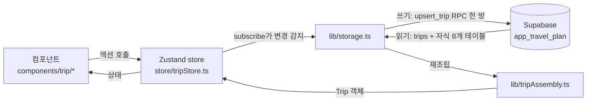

# ARCHITECTURE.md — 코드베이스 안내

이 문서는 **이 저장소의 코드가 실제로 어떻게 도는지**를 설명한다.
`docs/`의 다른 문서들(DATABASE, DESIGN, AUTH …)이 "지켜야 할 규칙"이라면, 이 문서는 "지금 있는 코드의 지도"다.

처음 읽는다면 [1. 한 장 요약](#1-한-장-요약) → [3. 저장은 자동이다](#3-저장은-자동이다-가장-중요) → [7. 자주 하는 작업](#7-자주-하는-작업) 순서를 권한다.

---

## 1. 한 장 요약

Next.js 16 App Router · React 19 · 전부 클라이언트 컴포넌트(`'use client'`)로 도는 SPA에 가까운 구조다.
서버는 두 가지 일만 한다: **외부 API 키를 숨기는 프록시**(`app/api/*`)와 **세션 쿠키 갱신**(`proxy.ts`).



기억할 것 세 가지:

1. **`Trip` 하나가 전부다.** 일정·항공·숙박·예산·후기가 전부 `Trip` 객체 안에 중첩된 트리로 들어있다 (`lib/types.ts`).
2. **컴포넌트는 저장을 호출하지 않는다.** store를 바꾸면 알아서 저장된다 ([3장](#3-저장은-자동이다-가장-중요)).
3. **읽기와 쓰기는 대칭이 아니다.** 쓰기는 RPC 한 방, 읽기는 9개 테이블 조회 후 재조립 ([4장](#4-읽기와-쓰기가-다른-이유)).

---

## 2. 파일 지도

| 경로 | 역할 |
|---|---|
| `store/tripStore.ts` | **모든 상태와 자동 저장.** 앱의 심장 |
| `lib/types.ts` | `Trip`/`ScheduleItem` 등 전체 도메인 타입 + 라벨·색상 상수 |
| `lib/storage.ts` | Supabase 읽기/쓰기, localStorage 폴백 |
| `lib/tripAssembly.ts` | 정규화된 DB row → 중첩된 `Trip` 객체로 재조립 |
| `lib/supabase.ts` | 브라우저 Supabase 클라이언트 (**스키마가 `app_travel_plan`으로 고정**) |
| `lib/routes.ts` | `/api/compute-route` 호출 헬퍼. 실패하면 throw 없이 `null` |
| `lib/utils.ts` | `cn`, 날짜 유틸, `googleMapsUrl` |
| `lib/places.ts` | `SelectedPlace` + `fetchSelectedPlace` — 검색·지도 클릭이 만나는 수렴점 |
| `hooks/usePlaceSuggestions.ts` | 장소 자동완성 제안 조회 (디바운스·세션토큰·race guard) |
| `components/place/*` | 자동완성 입력(`PlaceAutocompleteInput`)과 지도 선택(`PlaceMapPicker`) |
| `lib/budget.ts` | `toKRW`/`computeActuals` — 화면과 인쇄가 **반드시 공유** |
| `lib/staticMap.ts` · `lib/polyline.ts` | 인쇄용 정적 지도 URL 조립 (순수, Node에서 테스트 가능) |
| `lib/printOptions.ts` · `lib/printReady.ts` | 인쇄 옵션(쿼리스트링)과 인쇄 준비 게이트 |
| `hooks/useDayRoutes.ts` | 인쇄용 구간 경로 병렬 조회 + 중복제거 + 세션 캐시 |
| `proxy.ts` | Supabase 세션 쿠키 갱신 미들웨어 (Next.js 16은 `middleware.ts`가 아니라 `proxy.ts`) |
| `app/api/compute-route/route.ts` | Routes API 프록시 — 서버 전용 키를 숨기려고 존재 |
| `app/api/generate-report/route.ts` | NVIDIA(Llama 3.3 70B) 후기 생성 프록시 |
| `components/trip/*` | 일정·항공·숙박·예산 UI |
| `components/map/TripMap.tsx` | 지도 마커 + 경로 폴리라인 |
| `components/ui/*` | shadcn/ui 기반 공통 컴포넌트 (Base UI 기반) |

---

## 3. 저장은 자동이다 (가장 중요)

**컴포넌트 어디에도 `save()` 호출이 없다.** `store/tripStore.ts` 맨 아래 `subscribe`가 `trips` 배열을 감시하다가, **`updatedAt`이 달라진 trip만** 골라 자동으로 Supabase에 저장한다.

```
사용자가 일정 수정
  → store.updateScheduleItem()
  → touch()로 trip.updatedAt 갱신          ← 이게 저장 트리거
  → subscribe가 updatedAt 변화 감지
  → upsertTrip() → upsert_trip RPC
```

### ⚠️ 새 액션을 추가할 때 `touch()`를 빼먹으면 조용히 저장되지 않는다

store의 모든 변경 액션은 `touch(...)`(= `updatedAt` 갱신)를 거친다. 이걸 빠뜨리면 화면은 정상적으로 바뀌고 에러도 없는데 **새로고침하면 사라진다.** 변경 감지가 전적으로 `updatedAt` 비교이기 때문이다.

```ts
// store/tripStore.ts
const touch = (t: Trip): Trip => ({ ...t, updatedAt: new Date().toISOString() })
```

저장 실패는 `syncError`에 담겨 `components/SyncStatusBanner.tsx`로 사용자에게 노출된다 — 조용히 삼키지 않는다.

---

## 4. 읽기와 쓰기가 다른 이유

DB는 정규화되어 있는데(`schedule_items`, `flights`, … 9개 테이블) 앱은 중첩된 `Trip` 객체를 쓴다. 그 간극을 양쪽에서 다르게 메운다.

**쓰기 — `upsert_trip(p_trip jsonb)` RPC 한 번** (`lib/storage.ts` → `supabase/migrations/*_upsert_trip_function*.sql`)

`Trip` 객체를 통째로 jsonb로 넘기면, RPC가 트립 메타를 upsert하고 **자식 테이블을 전부 DELETE 후 재삽입**한다. 단일 트랜잭션이라 부분 저장이 없다. 대신 **필드를 추가하면 이 RPC도 반드시 고쳐야 한다** — 안 그러면 그 필드만 조용히 유실된다 ([7장](#7-자주-하는-작업)).

**읽기 — `trips` 조회 → 자식 8개 테이블 병렬 조회 → 재조립** (`lib/storage.ts` → `lib/tripAssembly.ts`)

`trips`를 먼저 가져와 `tripIds`를 얻은 뒤, 나머지 8개 테이블을 `Promise.all`로 한 번에 조회한다.

자식 테이블 하나가 실패해도 여행 전체를 숨기지 않는다. 실패한 테이블만 빈 값으로 두고 어떤 테이블이 실패했는지를 `loadError`로 표면화한다.

> 스키마 이름을 쿼리에 쓰지 않는 이유: `lib/supabase.ts`에서 클라이언트를 `{ db: { schema: 'app_travel_plan' } }`로 만들었기 때문에 `.from('trips')`가 이미 `app_travel_plan.trips`를 가리킨다. `public`이 아니다.

---

## 5. 화면 구조

- `app/page.tsx` — 여행 목록
- `app/trip/[id]/page.tsx` — **메인 화면.** 좌측 패널(일정/항공·숙박/예산/후기 탭) + 우측(지도 또는 후기 패널). 모바일에서는 좌측만 보이고 지도는 토글
- `app/trip/[id]/print/*`, `.../report/[reportId]/print` — 인쇄용 뷰

일정 UI 계층: `DaySchedule`(날짜별 목록 + dnd-kit 정렬) → `ScheduleItem`(카드) / `ScheduleForm`(추가·수정 다이얼로그)

**카테고리별로 폼 필드가 달라진다.** `lib/types.ts`의 `CATEGORY_EXTRA_FIELDS`가 그 매핑이다:

```ts
attraction: ['reservationNeeded'],
restaurant: ['mealType', 'reservationNeeded'],
hotel:      ['checkType', 'reservationNeeded'],
transport:  ['fromLocation', 'transportMode'],
```

---

## 6. 외부 연동

| 용도 | 키 | 위치 |
|---|---|---|
| 지도 표시 · 장소 검색 | `NEXT_PUBLIC_GOOGLE_MAPS_API_KEY` (브라우저) | `MapsProvider` → `TripMap`, `usePlaceSuggestions`, `PlaceMapPicker` |
| 도로 경로 계산 | `GOOGLE_ROUTES_API_KEY` (**서버 전용**) | `app/api/compute-route` |
| AI 후기 생성 | `NVIDIA_API_KEY` (서버 전용) | `app/api/generate-report` |

**키 두 개는 의도적으로 분리되어 있다.** 브라우저 키는 노출될 수밖에 없어 Places/Maps만 열어두고, Routes는 서버 전용 키로만 호출한다. Routes 키로 Places를 부르면 `API_KEY_SERVICE_BLOCKED`가 나는 게 정상이다.

키가 없어도 앱은 죽지 않는다 — `MapsProvider`는 지도/검색을 끄고, `fetchRoute`는 `null`을 반환해 지도가 직선 동선으로 폴백한다.

**인증**: Google OAuth(Supabase Auth) 하나뿐. `proxy.ts`가 매 요청 세션 쿠키를 갱신하고, 로그인 직후 `hydrate()`가 `app_id`/`role` 메타데이터를 심는다. 비로그인 상태의 localStorage 데이터는 첫 로그인 때 서버로 옮겨지며, **전부 성공했을 때만** 로컬 백업을 지운다.

---

## 7. 자주 하는 작업

### 일정(`ScheduleItem`)에 필드 추가하기

정규화 구조라 **6곳을 모두 고쳐야 한다.** 하나라도 빠지면 조용히 유실된다 — 특히 RPC.

1. `lib/types.ts` — `ScheduleItem`에 필드 추가 (카테고리 전용이면 `CATEGORY_EXTRA_FIELDS`에도)
2. `components/trip/ScheduleForm.tsx` — 입력 UI + `EMPTY` 초기값
3. `components/trip/ScheduleItem.tsx` — 카드에 표시
4. **새 마이그레이션** — `ALTER TABLE app_travel_plan.schedule_items ADD COLUMN …`
5. **같은 마이그레이션에서 `upsert_trip` RPC를 `CREATE OR REPLACE`** — INSERT 컬럼 목록과 SELECT 양쪽에 추가 (**여기를 빼먹는 게 제일 흔한 실수**)
6. `lib/tripAssembly.ts` — row 타입 + 매핑 추가

`lib/storage.ts`는 `select('*')`라 손댈 필요 없다.

마이그레이션 파일명은 **타임스탬프**(`YYYYMMDDHHMMSS_이름.sql`)로 만든다. 다른 프로젝트와 마이그레이션 히스토리를 공유하므로 순번은 충돌한다. `supabase db push`가 "Remote migration versions not found"를 뱉으면 **`migration repair`를 절대 실행하지 말고** 빈 스텁 파일로 우회한다.

### 화면 만들기

`docs/DESIGN.md`의 토큰을 쓴다. 모바일 우선이고, 실제 확인은 **402px(iPhone 17)** 기준으로 한다.

### 브라우저로 검증하기

로그인 없이는 `/trip/[id]`에 들어갈 수 없다. 특정 컴포넌트만 확인하려면 `app/dev-…-test/page.tsx` 같은 **임시 라우트를 만들어 컴포넌트만 mount**하고 끝나면 지운다. (폴더명을 `_`로 시작하면 App Router가 라우팅에서 제외하므로 주의.)

---

## 8. 함정 모음

실제로 겪은 것만 적었다. 전부 "에러 없이 조용히 잘못 도는" 종류다.

**`touch()` 누락 → 저장 안 됨.** [3장](#3-저장은-자동이다-가장-중요) 참고.

**`upsert_trip` RPC 갱신 누락 → 그 필드만 유실.** [7장](#7-자주-하는-작업) 참고.

**장소 검색 드롭다운을 감싸는 조상에 `overflow-*` 금지.** 제안 목록이 `absolute`로 뜨기 때문에 조상에 `overflow-hidden`이 걸리면 통째로 잘린다. 입력도 되고 요청도 200으로 나가는데 목록만 안 보여서 원인을 찾기 매우 어렵다(실제로 겪었다). 스크롤이 필요하면 드롭다운 자신에게만 건다. `DialogContent`에 같은 취지의 주석을 박아뒀다.

**Google 위젯(`PlaceAutocompleteElement`)으로 되돌리지 말 것.** 그 위젯은 좁은 화면에서 제안을 풀스크린 `<dialog>`로 띄우는데, 그게 closed shadow DOM 안에 있고 `part` 속성도 없어서 **CSS로 크기를 바꿀 방법이 전혀 없다**(CDP로 shadow DOM을 열어 확인). 모바일 UX 때문에 `AutocompleteSuggestion` Data API로 직접 만든 것이다.

**자동완성 세션 토큰은 곧 과금 단위다.** 타이핑 시작부터 선택(`fetchFields`)까지 하나를 재사용해야 세션 단위로 과금된다. 실패했다고 토큰을 살려두면 소비된 토큰을 계속 재사용해 **이후 요청이 전부 건당 과금**되므로 `finally`에서 버린다.

**Places 데이터를 지도 없이 표시하면 "Powered by Google" 표기가 의무다.** 위젯이 자동으로 해주던 것을 직접 만들면서 우리 책임이 됐다.

**`fetchRoute`의 duration/distance 가드.** `lib/routes.ts`가 `durationSeconds`/`distanceMeters`가 없으면 `null`을 반환한다. 이동시간을 UI에서 쓰지 않는다고 Routes API FieldMask에서 이 둘을 빼면 → `fetchRoute`가 `null` → **지도의 모든 도로 경로가 직선으로 조용히 퇴화한다.** 지금 안 쓰는 것처럼 보여도 지우지 말 것.

**일정 시각은 `startTime`/`endTime`("HH:MM" 문자열)이다.** `endTime < startTime`은 **익일이라는 뜻이며 유효하다**(심야 일정). 검증으로 막지 말 것. 계산은 `lib/utils.ts`의 `timeRangeMinutes`가 wrap을 처리하고, 표시는 `formatTimeRange`를 카드·인쇄가 공유한다 — 각자 문자열을 만들면 어긋난다.

**좌표에는 두 종류가 있다.** 검색으로 고른 좌표는 이름과 한 쌍이라 이름을 고치면 무효화하는 게 맞지만, 지도에서 찍거나 숙소에서 가져온 좌표는 이름과 무관하게 살아남아야 한다(`ScheduleForm`의 `coordsPinned`). 이걸 구분하지 않으면 지도에서 찍고 이름을 지웠을 때 좌표가 조용히 버려진다.

**Base UI `Select`에 `items` prop을 넘기지 않으면** 트리거에 라벨 대신 raw value가 표시된다. `ScheduleForm`의 `TRANSPORT_SELECT_ITEMS` 같은 상수가 그래서 있다.

**인쇄 CSS에서 `print-color-adjust: exact`를 빼지 말 것.** 브라우저 인쇄는 기본적으로 배경 그래픽을 끄기 때문에, 이게 없으면 배경색 위의 흰 글씨(번호 마커·날짜 뱃지)가 통째로 사라지고 타입별 색 코딩도 무력화된다. `printBackground:false`로 PDF를 만들어 A/B로 확인한 값: 규칙 있을 때 유채색 fill 89개, 없을 때 54개.

**페이지를 넘길 수 있는 크기의 요소에 `break-inside: avoid`를 걸지 말 것.** 한 페이지보다 큰 블록에서는 브라우저가 avoid를 무시하면서 앞 페이지에 큰 여백만 남긴다. 하루 일정 전체에 걸어놨다가 겪은 문제다. 제목 행·지도·일정 한 줄처럼 확실히 한 페이지에 들어가는 단위에만 쓴다.

**인쇄 시점은 타이머가 아니라 게이트다.** 데이터 → 경로 조회 → 이미지 디코딩이 비동기 사슬이라 `setTimeout` 추측값으로는 지도가 도착하기 전에 인쇄 다이얼로그가 뜬다. `lib/printReady.ts`의 `waitForAssets()`가 폰트와 이미지를 기다리고 8초 하드 타임아웃을 둔다. 인쇄 센티널(`printedRef`)은 **실제 인쇄 시점에** 세워야 한다 — 진입 시점에 세우면 StrictMode의 2회 실행에서 1차가 취소된 뒤 2차가 "이미 인쇄함"으로 판단해 아무도 인쇄하지 않는다.

**인쇄 페이지의 store 구독은 셀렉터로 좁힐 것.** `useTripStore()`를 통째로 구독하면 store의 어떤 변경에도 `trip` identity가 바뀌어 경로 조회가 무한 재실행되며 **조용히 과금된다.** 마찬가지로 지도를 끌 때는 `display:none`이 아니라 컴포넌트를 아예 렌더하지 않아야 요청이 안 나간다.

**Static Maps 마커 라벨은 한 글자만 된다.** `label:10`은 빈 마커로 렌더된다(실측). `lib/staticMap.ts`의 `stopLabel`이 10번째부터 `A`로 넘기며, **지도·범례·목록이 전부 이 함수를 공유해야** 한다 — 규칙이 두 벌이면 같은 종이에 "10번"과 "A"가 같이 나온다.

**폴리라인을 URL에 넣을 때는 `encodeURIComponent`를 정확히 한 번.** 인코딩된 폴리라인에는 `?` `@` `\` `|`가 실제로 들어있고(`|`는 Static Maps 자체 구분자) 안 하면 요청이 깨진다. 두 번 하면 에러 없이 경로만 조용히 사라진다.

**Supabase JWT는 레거시 HS256을 유지해야 한다.** 공유 프로젝트라 ES256으로 바꾸면 Data API 검증이 깨져 다른 앱까지 같이 죽는다.

**서비스 워커(`public/sw.js`)가 cache-first다.** 디버깅이 이상하면 SW를 먼저 unregister하고 확인한다.

---

## 9. 더 읽을 것

| 문서 | 내용 |
|---|---|
| [DATABASE.md](./DATABASE.md) | 스키마 분리 규칙 (일반 규칙) |
| [DESIGN.md](./DESIGN.md) | 디자인 토큰·컴포넌트 스펙 |
| [AUTH.md](./AUTH.md) | 인증 전략 |
| [DEPLOYMENT.md](./DEPLOYMENT.md) | 배포 절차 |
| [IOS_WEBAPP.md](./IOS_WEBAPP.md) | PWA / iOS 설정 |
